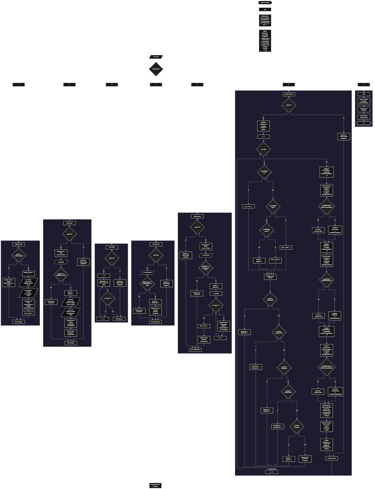

Este proyecto, llamado <b>atletismo olímpico</b>, fue desarrollado en <b>java</b> como un ejercicio práctico para fortalecer la lógica de programación mediante la creación de un sistema de gestión de atletas olímpicos desde la consola. El programa cuenta con un menú principal de siete opciones que permite <b>registrar, editar, listar, buscar, eliminar y consultar información estadística</b> de los atletas registrados. Cada atleta almacena datos como el nombre, país, prueba deportiva, categoría, marca, unidad, posición, medalla, año olímpico y estado, utilizando arreglos con una capacidad máxima de <b>10 atletas durante la ejecución</b>. Durante su desarrollo se aplicaron conceptos fundamentales de programación, como variables, arreglos, estructuras condicionales, ciclos repetitivos y estructuras de selección, además de procesos para buscar, modificar, eliminar y organizar registros. También se implementaron análisis estadísticos para identificar las pruebas, países y categorías más frecuentes, así como contabilizar las medallas y los estados de los atletas. Este proyecto permite poner en práctica los conocimientos adquiridos en java y sirve como base para desarrollar sistemas de gestión más avanzados utilizando otros lenguajes y tecnologías.

<h2 align="center">⚙️ Funcionamiento del menú principal</h2>

### ➕ Registrar atleta

La opción <b>1) registrar atleta</b> permite almacenar un nuevo atleta en el sistema. Antes de realizar el registro, el programa comprueba que la cantidad de atletas almacenados sea menor a <b>10</b>, utilizando la condición <b>total >= nombres.length</b> para detectar si se alcanzó la capacidad máxima de los arreglos. Si existe espacio disponible, muestra el identificador del nuevo atleta mediante la expresión <b>total + 1</b> y solicita los datos correspondientes: <b>nombre, país, prueba, categoría, marca, unidad, posición, medalla, año olímpico y estado</b>. La información se almacena en la posición actual de sus respectivos arreglos. Finalmente, aumenta la variable <b>total</b> en uno y muestra el mensaje <b>"Atleta registrado correctamente."</b>. Si los arreglos alcanzan su capacidad máxima, presenta el mensaje <b>"No hay espacio para registrar mas atletas."</b>, impidiendo almacenar otro registro.

### ✏️ Editar atleta

La opción <b>2) editar atleta</b> permite modificar la información de un atleta registrado. Primero, el programa comprueba si existen atletas almacenados mediante la condición <b>total == 0</b>. Si no hay registros, muestra el mensaje <b>"No existen atletas registrados."</b>. En caso contrario, presenta una lista con el identificador, nombre, país, prueba, categoría, marca, unidad, posición, medalla, año olímpico y estado de cada atleta. Después, solicita el identificador del atleta que se desea editar y comprueba que esté dentro del rango permitido mediante la condición <b>idEditar >= 1 && idEditar <= total</b>. Si la selección es válida, calcula la posición correspondiente mediante <b>posicion = idEditar - 1</b> y solicita los nuevos datos del atleta. La información anterior se reemplaza directamente en los diez arreglos correspondientes. Finalmente, presenta el mensaje <b>"Atleta actualizado correctamente."</b>. Si el identificador seleccionado no corresponde a un atleta registrado, muestra el mensaje <b>"ID no encontrada."</b>.

### 📋 Listar atletas

La opción <b>3) listar atletas</b> permite visualizar todos los atletas registrados actualmente en el sistema. Antes de mostrar la información, el programa comprueba si la variable <b>total</b> es igual a <b>0</b>. Si no existen registros, presenta el mensaje <b>"No existen atletas registrados."</b>. Si hay atletas disponibles, muestra el encabezado <b>"lista de atletas olimpicos"</b> y utiliza un ciclo <b>for</b> para recorrer los arreglos desde la primera posición hasta la cantidad total de atletas registrados. Durante el recorrido, muestra el identificador generado mediante <b>i + 1</b> y los diez datos correspondientes a cada atleta: nombre, país, prueba, categoría, marca, unidad, posición, medalla, año olímpico y estado. Esta función facilita consultar todos los registros existentes sin necesidad de buscar cada atleta individualmente.

### 🔎 Buscar atleta

La opción <b>4) buscar atleta</b> permite localizar un atleta mediante su identificador. Primero, el programa comprueba si existen atletas registrados. Si no hay información almacenada, muestra el mensaje <b>"No existen atletas registrados."</b>. En caso contrario, solicita el identificador del atleta que se desea buscar y verifica que esté dentro del rango permitido mediante la condición <b>idBusqueda >= 1 && idBusqueda <= total</b>. Si el identificador es válido, calcula la posición correspondiente utilizando <b>posicion = idBusqueda - 1</b> y muestra los datos completos del atleta encontrado: nombre, país, prueba, categoría, marca, unidad, posición, medalla, año olímpico y estado. Si el identificador introducido no corresponde a ningún registro existente, presenta el mensaje <b>"ID no encontrada."</b>. Esta búsqueda utiliza el identificador para acceder directamente a la posición del atleta dentro de los arreglos, sin realizar un recorrido de búsqueda.

### 🗑️ Eliminar atleta

La opción <b>5) eliminar atleta</b> permite eliminar un atleta registrado mediante su identificador dentro de la lista. Antes de comenzar, el programa comprueba que existan atletas almacenados. Si no hay registros, muestra el mensaje <b>"No existen atletas registrados."</b>. Si hay información disponible, presenta una lista con los datos de todos los atletas. Después, solicita el identificador del atleta que se desea eliminar y verifica que la selección esté dentro del rango permitido mediante la condición <b>idEliminar >= 1 && idEliminar <= total</b>. Si el identificador es válido, calcula la posición mediante <b>posicion = idEliminar - 1</b> y comienza el proceso de eliminación. Para mantener los registros organizados, utiliza un ciclo <b>for</b> controlado por la variable <b>i</b>, que desplaza una posición hacia la izquierda los datos de los atletas posteriores en los diez arreglos: <b>nombres, paises, pruebas, categorias, marcas, unidades, posiciones, medallas, aniosOlimpicos y estados</b>. Posteriormente, disminuye la variable <b>total</b> en uno y muestra el mensaje <b>"Atleta eliminado correctamente."</b>. Si el identificador seleccionado no corresponde a un atleta registrado, presenta el mensaje <b>"ID no encontrada."</b>.

### 📊 Mostrar resumen

La opción <b>6) mostrar resumen</b> permite consultar información estadística sobre los atletas registrados. Primero, el programa comprueba si existen registros almacenados. Si no hay atletas, muestra el mensaje <b>"No existen atletas registrados."</b>. En caso contrario, inicializa diferentes contadores y utiliza un ciclo <b>for</b> para recorrer los registros y clasificar la información de acuerdo con las medallas y los estados de cada atleta. Para las medallas, contabiliza los registros de <b>oro, plata, bronce y sin medalla</b>, utilizando las variables <b>oro, plata, bronce y ninguna</b>. Para los estados, contabiliza los atletas <b>clasificados, en competencia, finalizados, descalificados y retirados</b>, mediante las variables <b>clasificados, competencia, finalizados, descalificados y retirados</b>. Las comparaciones se realizan utilizando el método <b>equalsIgnoreCase()</b>, que permite reconocer los valores sin distinguir entre mayúsculas y minúsculas.

Además, el programa realiza tres análisis de frecuencia para identificar la información que más se repite entre los atletas registrados. El primero determina la <b>prueba más frecuente</b>, utilizando los arreglos <b>pruebas</b> y las variables <b>pruebaMayor y cantidadPruebaMayor</b>. El segundo identifica el <b>país con más atletas</b>, mediante los arreglos <b>paises</b> y las variables <b>paisMayor y cantidadPaisMayor</b>. El tercero determina la <b>categoría más frecuente</b>, utilizando los arreglos <b>categorias</b> y las variables <b>categoriaMayor y cantidadCategoriaMayor</b>. Para realizar estos análisis, utiliza ciclos <b>for anidados</b> que comparan los valores almacenados mediante <b>equalsIgnoreCase()</b> y contabilizan las coincidencias. Cuando una cantidad supera la frecuencia máxima registrada, el programa actualiza el resultado correspondiente. Finalmente, muestra el total de atletas registrados, la prueba más frecuente, el país con más atletas, la categoría más frecuente, la cantidad de medallas y los diferentes estados de los atletas.

### 🚪 Salir del menú principal

La opción <b>7) salir</b> está destinada a finalizar la ejecución del programa y muestra el mensaje <b>"Gracias por utilizar Atletismo Olimpico."</b>. El menú principal se encuentra dentro de una estructura repetitiva <b>do-while</b>, que mantiene el programa en funcionamiento mientras la opción seleccionada sea diferente de <b>7</b>. Cuando el usuario selecciona esta opción, el programa ejecuta el bloque correspondiente y termina el ciclo mediante la condición <b>opcion != 7</b>. Finalmente, cierra el objeto <b>Scanner</b> utilizando la instrucción <b>entrada.close()</b>, finalizando la ejecución del programa.

<h2 align="center">🧠 Temas aplicados en el proyecto</h2>

### 📦 Variables

En este proyecto se utilizan variables para almacenar la opción seleccionada en el menú, controlar la cantidad de atletas registrados, recorrer los arreglos, seleccionar los atletas que se desean editar, buscar o eliminar y realizar los diferentes análisis estadísticos. También se utilizan variables auxiliares para contabilizar las medallas, clasificar los estados y determinar las pruebas, países y categorías más frecuentes. Cada variable cumple una función específica dentro de las operaciones de gestión de atletas.

🔢 **Opcion:** Almacena la opción seleccionada por el usuario en el menú principal.

📊 **Total:** Almacena la cantidad actual de atletas registrados.

🔄 **I:** Funciona como contador en los ciclos `for` y permite recorrer los arreglos y seleccionar las posiciones de los atletas.

🔁 **J:** Controla el recorrido interno de los ciclos `for` anidados utilizados para comparar los registros durante los análisis de frecuencia.

📍 **Posicion:** Almacena la posición correspondiente al identificador seleccionado para editar, buscar o eliminar un atleta.

🆔 **IdEditar, IdBusqueda e IdEliminar:** Almacenan los identificadores introducidos por el usuario para realizar las operaciones correspondientes.

🏅 **Oro, Plata, Bronce y Ninguna:** Almacenan las cantidades de atletas que tienen medallas de oro, plata, bronce o ninguna medalla.

📋 **Clasificados, Competencia, Finalizados, Descalificados y Retirados:** Almacenan las cantidades correspondientes a los diferentes estados de los atletas.

📈 **PruebaMayor, PaisMayor y CategoriaMayor:** Almacenan la prueba, el país y la categoría que presentan la mayor frecuencia entre los registros.

🔢 **CantidadPruebaMayor, CantidadPaisMayor y CantidadCategoriaMayor:** Almacenan las cantidades máximas encontradas durante los análisis de frecuencia.

### 🗃️ Arreglos

En este proyecto se utilizan diez arreglos relacionados con los datos de cada atleta. Cada arreglo tiene una capacidad de <b>10 posiciones</b> y utiliza el mismo índice para representar la información correspondiente a una misma persona. Por ejemplo, los datos de un atleta almacenado en la posición <b>0</b> se encuentran distribuidos entre <b>nombres[0], paises[0], pruebas[0], categorias[0], marcas[0], unidades[0], posiciones[0], medallas[0], aniosOlimpicos[0] y estados[0]</b>. Esta organización permite recorrer, buscar, modificar, mostrar y eliminar los registros de manera ordenada.

📝 **Nombres[10]:** Almacena los nombres de los atletas registrados.

🌎 **Paises[10]:** Almacena los países a los que pertenecen los atletas.

🏃 **Pruebas[10]:** Almacena las pruebas deportivas en las que participan los atletas.

📂 **Categorias[10]:** Almacena las categorías correspondientes a cada atleta.

📏 **Marcas[10]:** Almacena las marcas obtenidas por los atletas.

📐 **Unidades[10]:** Almacena las unidades utilizadas para representar las marcas.

🏆 **Posiciones[10]:** Almacena las posiciones alcanzadas por los atletas.

🥇 **Medallas[10]:** Almacena las medallas obtenidas por los atletas.

📅 **AniosOlimpicos[10]:** Almacena los años olímpicos correspondientes a cada registro.

📋 **Estados[10]:** Almacena los estados de los atletas, como clasificado, competencia, finalizado, descalificado o retirado.

### 🔀 Estructuras condicionales

En este proyecto se utilizan las estructuras <b>if, else if y else</b> para comprobar diferentes condiciones durante las operaciones del programa. Estas estructuras permiten verificar si los arreglos tienen espacio disponible antes de registrar un atleta, comprobar si existen registros antes de realizar determinadas operaciones, validar los identificadores seleccionados para editar, buscar o eliminar y clasificar las medallas y los estados durante la elaboración del resumen. También permiten determinar cuándo una frecuencia encontrada supera la cantidad máxima registrada y cuándo se debe mostrar un mensaje de error.

### 🔄 Estructuras repetitivas

En este proyecto se utilizan los ciclos <b>do-while</b> y <b>for</b>. El ciclo <b>do-while</b> mantiene activo el menú principal y permite que el usuario seleccione diferentes operaciones hasta elegir la opción de salida. Por otro lado, los ciclos <b>for</b> permiten recorrer los arreglos para mostrar los atletas registrados, presentar la información antes de editar o eliminar y contabilizar las medallas y los estados. También se utilizan ciclos <b>for anidados</b> para comparar los elementos de los arreglos y encontrar la prueba, el país y la categoría que aparecen con mayor frecuencia. Durante la eliminación, otro ciclo <b>for</b> permite desplazar los datos de los atletas posteriores para reorganizar los registros.

### 🎯 Estructura switch

El programa utiliza la estructura <b>switch</b> para evaluar el valor almacenado en la variable <b>opcion</b> y ejecutar el bloque de instrucciones correspondiente. Cada caso representa una operación específica del sistema: <b>registrar atleta, editar atleta, listar atletas, buscar atleta, eliminar atleta, mostrar resumen o salir</b>. También se utiliza el bloque <b>default</b> para mostrar el mensaje <b>"Opcion no valida."</b> cuando el usuario introduce un número que no coincide con ninguna de las opciones definidas en el menú. Esta estructura permite organizar las funcionalidades del programa y facilitar la selección de cada operación.

### 🔢 Dimensionamiento de arreglos

El programa utiliza la instrucción <b>new String[10]</b> para establecer la capacidad de los arreglos que almacenan la información de los atletas. Se definieron <b>10 posiciones</b> para cada uno de los diez arreglos, lo que permite administrar hasta 10 atletas durante la ejecución. La cantidad de posiciones ocupadas se controla mediante la variable <b>total</b>, mientras que la propiedad <b>length</b> permite consultar la capacidad de los arreglos y comprobar si existe espacio disponible antes de registrar un nuevo atleta.

### 🔄 Reorganización de registros

Cuando se selecciona un atleta para eliminarlo, el programa utiliza un ciclo <b>for</b> que comienza en la posición seleccionada y continúa hasta <b>total - 1</b>. En cada repetición, los datos de la posición siguiente se copian sobre la posición actual en los diez arreglos: <b>nombres, paises, pruebas, categorias, marcas, unidades, posiciones, medallas, aniosOlimpicos y estados</b>. Después, la variable <b>total</b> disminuye en uno para actualizar la cantidad de atletas registrados. De esta manera, los registros posteriores ocupan las posiciones anteriores sin dejar espacios vacíos dentro del rango de registros activos. El código no limpia explícitamente la última posición que queda fuera del total actualizado.

<h2 align="center">¿Cómo se implementaron las operaciones crud en el proyecto?</h2>

Las operaciones <b>crud</b> se implementaron mediante las opciones del menú principal, permitiendo administrar los atletas registrados. La operación <b>crear</b> corresponde a <b>registrar atleta</b>, donde se introducen los datos de un nuevo participante; <b>leer</b> se realiza mediante las opciones <b>listar atletas, buscar atleta y mostrar resumen</b>, que permiten consultar los registros y obtener información estadística; <b>actualizar</b> corresponde a <b>editar atleta</b>, donde se modifican los datos de un participante registrado; y <b>eliminar</b> se realiza mediante la opción <b>eliminar atleta</b>, que permite retirar un registro y reorganizar los arreglos. Estas operaciones utilizan variables, arreglos, estructuras condicionales y ciclos para gestionar la información almacenada temporalmente durante la ejecución del programa.

<h2 align="center">Diagrama de flujo del proyecto</h2>

<h2 align="center">🛡️ Validaciones del programa</h2>

### 📭 No existen atletas registrados

Esta validación se utiliza en las opciones de <b>editar, buscar, eliminar y mostrar resumen</b>, además de la opción de listar atletas. El programa comprueba si la variable <b>total</b> es igual a <b>0</b> y, si no existen registros, muestra el mensaje <b>"No existen atletas registrados."</b>. Esta comprobación evita continuar con las operaciones que necesitan información almacenada cuando no hay atletas registrados.

### ⚠️ Capacidad máxima alcanzada

Esta validación se utiliza durante el registro de nuevos atletas para controlar la capacidad máxima de los arreglos. El programa comprueba si <b>total >= nombres.length</b> antes de permitir agregar un nuevo registro. Si existe espacio disponible, solicita los diez datos del atleta y aumenta el contador <b>total</b> en uno. En caso contrario, muestra el mensaje <b>"No hay espacio para registrar mas atletas."</b>, impidiendo almacenar más atletas cuando se alcanza la capacidad máxima de 10 registros.

### ❌ Identificador no encontrado

Esta validación se utiliza durante las operaciones de <b>editar, buscar y eliminar atletas</b>. El programa comprueba que el identificador introducido sea mayor o igual a <b>1</b> y menor o igual al valor de <b>total</b>. Si la selección está dentro del rango permitido, calcula la posición correspondiente y realiza la operación solicitada. Si el identificador no corresponde a un atleta registrado, muestra el mensaje <b>"ID no encontrada."</b>. Esta comprobación evita acceder a posiciones que no corresponden a registros activos.

### 🔢 Identificación de posiciones

El programa utiliza los identificadores para localizar directamente la posición de cada atleta dentro de los arreglos. Para realizar esta conversión, utiliza la expresión <b>posicion = id - 1</b>, debido a que los identificadores comienzan desde <b>1</b>, mientras que las posiciones de los arreglos comienzan desde <b>0</b>. Esta operación se aplica durante la edición, búsqueda y eliminación de atletas, permitiendo acceder a la información correspondiente al registro seleccionado.

### ⚠️ Opción no válida

La estructura <b>switch</b> incluye el bloque <b>default</b>, que muestra el mensaje <b>"Opcion no valida."</b> cuando el usuario introduce un número que no corresponde a ninguna de las siete opciones definidas en el menú principal. Esta condición permite informar al usuario cuando selecciona una opción que no está disponible en el sistema.

### 🔠 Comparaciones sin distinción entre mayúsculas y minúsculas

Durante la elaboración del resumen, el programa utiliza el método <b>equalsIgnoreCase()</b> para comparar las medallas, los estados, las pruebas, los países y las categorías almacenadas en los arreglos. Este método permite reconocer valores equivalentes aunque se hayan introducido utilizando letras mayúsculas o minúsculas. De esta manera, las comparaciones estadísticas no dependen de la combinación de letras utilizada al registrar la información.

### ⚠️ Datos de entrada no validados

El programa solicita los datos de cada atleta mediante el objeto <b>Scanner</b> y utiliza <b>nextLine()</b> para almacenar la información como texto. Sin embargo, el código no incluye comprobaciones específicas para impedir campos vacíos ni valida formatos o valores permitidos para las marcas, unidades, posiciones, años olímpicos, medallas y estados. Tampoco implementa un manejo de excepciones para controlar entradas incompatibles con <b>nextInt()</b>. Por esta razón, la información se almacena de acuerdo con los valores introducidos por el usuario, sin realizar validaciones adicionales sobre su contenido.

<h2 align="center">🎯 Objetivo del proyecto</h2>

El objetivo principal de este proyecto es fortalecer la <b>lógica de programación</b> mediante el desarrollo de un sistema de gestión de atletas olímpicos en <b>java</b>. A través de su construcción se busca aplicar los conocimientos adquiridos sobre variables, arreglos, estructuras condicionales, ciclos repetitivos y estructuras de selección, integrándolos para resolver un problema de manera organizada. Además, el proyecto permite comprender cómo registrar, consultar, modificar y eliminar información utilizando arreglos, así como realizar análisis estadísticos para obtener datos relevantes sobre los atletas, sus pruebas deportivas, países, categorías, medallas y estados. De esta manera, se establece una base para desarrollar sistemas de gestión más completos con otros lenguajes y tecnologías.

